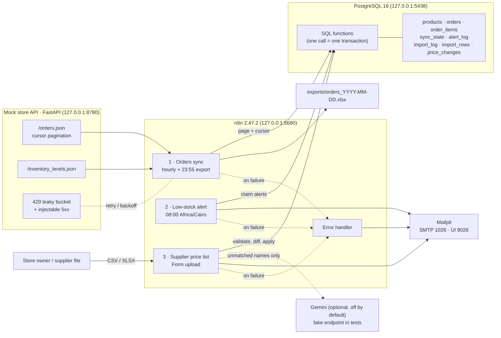

# P8 — n8n Back-office Automations

[](https://github.com/zeyadosmoh/n8n-backoffice-automations/actions/workflows/ci.yml)

> **⚠️ Synthetic data.** Every product, order, inventory level, supplier and price list in this repository is
> generated by a seeded script (`mock_store/`, `python -m p8 sample-pricelists`). No real store, supplier or
> customer data is used. Every email, Excel export and form page this project produces says so.

A portfolio project for a freelance service: three back-office automations a small online store would pay for,
built in **n8n 2.47.2** on PostgreSQL 16. They run against a mock Shopify-style store API that rate-limits and
fails on purpose.

| Workflow | Trigger | What it does |
|---|---|---|
| **1. Orders sync** | hourly (+ daily 23:55 export) | Pulls new/updated orders **and inventory levels** since a cursor with retries and backoff, upserts them, moves the cursor only in the same transaction as the rows, and writes a daily Excel file. Idempotent. |
| **2. Low-stock alert** | daily 08:00 Africa/Cairo | SKUs below their reorder point → **one** HTML email sorted by days of stock left (from the last 14 days of sales), at most one alert per SKU per day. |
| **3. Supplier price list** | n8n Form upload | CSV/XLSX → validate (required columns, numeric prices > 0, duplicate SKUs, unknown SKUs) → diff against current prices → apply valid rows in **one transaction** → summary email + rejects file with a reason per row. Optional AI name-to-SKU matching that only ever fills a **review list**. |
| **Error handler** | n8n Error Trigger | Emails the workflow, failing node, message and a link to the execution. |

Screenshots: see [Screenshots](#screenshots).

## What this proves

All numbers are from one local run from zero (`docker compose down -v`, then the [Quickstart](#quickstart-from-zero)
and `scripts/demo.py`) on 2026-11-18.

- **Sync that survives a bad API and never double-counts.**
  - First sync: **1,383 orders (2,299 line items) over 6 pages plus 52 inventory levels, 3.1 s.** An immediate
    rerun re-reads the 5-minute overlap window (14 orders, 52 levels) and changes **0 rows**.
  - A full resync from an empty database under **30% random 5xx and a 2-request rate-limit bucket at 0.5 req/s**
    finished in 19.2 s. It took 17 API calls, 4 server errors retried with backoff and 6 × 429 waits honouring
    `Retry-After`. The database matched the store exactly: **1,413 orders, 2,357 lines, total stock 4,450**. The
    rerun changed 0 rows.
  - With the API returning 500 on every call, the run gave up after 5 retries (33.0 s). **No rows were written,
    the cursor did not move**, and one failure email named the node (`Check response`) and linked the execution. The
    next healthy run picked up exactly the 3 waiting orders.
- **Alerts people can act on, without spam.** The daily email listed SKU-1039 (out of stock), SKU-1008 (21.0 days
  left) and SKU-1050 (84.0 days), sorted by days left. A second run the same day sent nothing. A simulated order of
  16 × SKU-1010 (stock 30, reorder point 15) reached `products.stock` through the inventory sync (now 14). The next
  alert contained **only SKU-1010**, and the run after that sent nothing. If the email fails, the alert is retried on
  the next run instead of being lost.
- **Price imports that can't half-apply.** The bad sample (12 rows) applied **3 valid rows and rejected 9**, each
  with its own reason (not a number, ≤ 0, missing, unknown SKU, duplicate SKU in rows 9 and 10, no SKU or name,
  comma decimal). The good sample (24 rows) changed **17 prices and left 7 unchanged**. Uploading it again changed
  **0**. A forced database error during apply rolls back every price and every log row (tested).
- **AI kept on a leash.** With AI matching on, two supplier names only AI could match (plurals) went to `review.csv`
  with confidence 1.00 and **were not applied**. "Linen Towel Natural" (0.75, below the 0.85 threshold) was rejected
  with the AI's best guess in the reason. AI matching is off by default and only sees rows the rules could not match.
- **No secrets in the exports.** The 4 workflow JSON files reference credentials by id and name only.
  `scripts/check_workflows_clean.py` fails the build if any `.env` secret value (including the run-now webhook token)
  or a token-shaped string appears in them, or if a webhook lacks Header Auth. It runs in the secret scan and in CI.
- **Tested end to end.** 67 pytest tests:
  - 54 unit and SQL tests: mock API, every SQL function, samples, workflow leak checks.
  - 13 e2e tests that import the workflows into a throwaway n8n and trigger them through their webhooks and the
    form. They assert database rows and Mailpit emails (through the Mailpit API) and the Excel file. The same suite
    runs in GitHub Actions against n8n, Postgres and Mailpit service containers, with `REQUIRE_N8N=1`, so a skipped
    e2e test fails the build.

## Architecture



**Design rule:** n8n orchestrates and the database decides. Every business rule lives in a PostgreSQL function
(`db/migrations/00*.sql`), because one function call runs as one transaction and pytest can check it directly:
- upserts and the cursor;
- days of stock left and the alert claim;
- price validation, diff and apply.

The n8n nodes do the I/O: HTTP, files, email, form, schedule. Their Code-node JavaScript lives in
`workflows/src/*.js`, and `scripts/build_workflows.py` assembles the importable JSON exports from it. CI fails if a
committed export is out of date.

### Workflow 1 · Orders sync

`Every hour (:05)` or `Run now (webhook)` → **Load cursors** → **Start streams** → loop:
**Next request** → **Fetch page** (HTTP, store credential) → **Check response** → **Retry or apply?**
- 429 → **Back off** for `Retry-After` seconds, then loop. 429s have their own budget of 20 waits.
- 5xx or network error → **Back off** 1, 2, 4, 8, 16 s + jitter, then loop. The run fails after 5 retries.
- 200 → **Apply page (one transaction)**: rows plus cursor → **Next page?** follows the `Link` header, then switches
  from `orders` to `inventory_levels` → **Sync summary**.

The cursor is `(updated_at, id)` of the newest committed row. It only moves forward, and only inside the same
transaction as the page it covers. Each run starts 5 minutes before the cursor (`updated_at_min` is inclusive). An
order or level is rewritten only if its store `updated_at` is not older **and** its content changed. That makes
reruns write nothing, and two updates within the same second are not lost. **Inventory levels** (Change A) use the
same rules and update `products.stock`.

The export branch (`Daily 23:55` or `Export now (webhook)`, optional `{"day": "YYYY-MM-DD"}`) writes
`exports/orders_<day>.xlsx` (sheet "Orders (synthetic data)") with one row per order line. Times are Cairo local time
and amounts are numbers.

### Workflow 2 · Low-stock alert

`Daily 08:00 Cairo` or `Run now (webhook)` → **Claim today's alerts** → **Build email** → **Anything to send?** →
**Send low-stock email** → **Mark alerts sent**.

`alert_log` has one row per SKU per Cairo day (unique key). A claim returns the SKUs inserted now plus any claimed
earlier today whose email failed (`sent_at` empty). So "at most one alert per SKU per day" means one *sent* alert,
and a mail outage doesn't silently drop alerts.

Days left = stock ÷ (units sold in the last 14 days ÷ 14), counting non-cancelled orders only. No sales gives "no
recent sales", sorted last.

### Workflow 3 · Supplier price list

**Price list upload form** (`http://127.0.0.1:5680/form/p8-price-list`) → **Detect file type** → **CSV or XLSX?** →
**Read CSV / Read XLSX** → **Collect rows** → **Validate + diff** → **Rows for AI?** →
[**Load catalog** → **Build AI prompt** → **Ask Gemini** → **Parse AI answer** → **Record AI matches (review only)**] →
**Apply valid rows (one transaction)** → **Build summary** → **Send summary email** → **Show result to uploader**.

**Headers:**
- Matched loosely: `SKU`, `Item Code`, `Product Name`, `Unit Price (EGP)` and so on.
- Required: a price column, plus a SKU or name column. Otherwise the whole file is rejected with the reason.

**Every row is checked:**
- The price must be a number > 0. `1,250.00` and `EGP 99` are accepted; `12,5` is not.
- The SKU must exist in the catalog.
- Rows without a SKU are matched by name: the exact name first, then the same words in any order. The match must be
  unambiguous.
- A SKU that appears twice is rejected in every copy, because we can't know which price is right.

**Applying:** all valid rows are applied in one function call. A failed row means nothing is applied. Row numbers are
spreadsheet rows (header = row 1). Changes of 30% or more are highlighted in the email. The person uploading sees
the counts on the form's completion page.

**Optional AI matching** (`AI_MATCH_ENABLED=true` + `GEMINI_API_KEY`):
- Only rows that no rule could match are sent to Gemini (`gemini-3.5-flash-lite`, JSON schema output, temperature 0).
- The model returns `{row_no, sku, confidence}`. A suggestion at or above `AI_MATCH_MIN_CONFIDENCE` (0.85) goes to the
  **review list** (`review.csv` + an email section). It is **never applied**.
- Lower confidence, an invented SKU, or an API error rejects the row with the reason.
- Tests and CI use a word-overlap **fake** Gemini endpoint in the mock store, so no key is needed.

### Error handler

Each workflow sets `settings.errorWorkflow` to it. The email contains the workflow name and id, the node, the error
message, the mode, the Cairo time, and `<N8N_EDITOR_BASE_URL>/workflow/<id>/executions/<execution id>`. The base URL
comes from the `N8N_EDITOR_BASE_URL` setting (default `http://localhost:5680`); the e2e stack sets it to
`http://localhost:5681` and checks the link.

## Quickstart (from zero)

You need Python 3.12+ and Docker. Nothing is installed system-wide: dependencies go into a project `.venv`.

```bash
python3 -m venv .venv && .venv/bin/pip install -e '.[dev]'
python3 scripts/setup_env.py                 # .env with random secrets (never overwrites)
docker compose up -d --build --wait          # n8n 5680, Postgres 5438, mock store 8780, Mailpit 1026/8026 (127.0.0.1)
.venv/bin/python -m p8 migrate               # db/migrations (idempotent)
.venv/bin/python -m p8 seed-products         # 52 synthetic SKUs
scripts/import_workflows.sh                  # credentials from .env + 4 workflows -> n8n, published
.venv/bin/python scripts/demo.py             # replays every scenario above and prints the numbers
.venv/bin/python -m pytest                   # unit + SQL tests (database p8_test); e2e skipped
RUN_E2E=1 .venv/bin/python -m pytest tests/e2e   # throwaway n8n stack on 5681/5439/8781/1027/8027, ~3 min
```

Then:
- **n8n** at http://localhost:5680: create the owner account on first visit to see the workflows and executions.
- **Mailpit** at http://localhost:8026 for every email.
- The **form** at http://localhost:5680/form/p8-price-list (try the files in `samples/`).

**Run any workflow now** with its token-protected webhook:

```bash
set -a; . ./.env; set +a
curl -X POST -H "X-P8-Token: $N8N_WEBHOOK_TOKEN" http://127.0.0.1:5680/webhook/p8/orders-sync
curl -X POST -H "X-P8-Token: $N8N_WEBHOOK_TOKEN" http://127.0.0.1:5680/webhook/p8/low-stock
curl -X POST -H "X-P8-Token: $N8N_WEBHOOK_TOKEN" -H 'content-type: application/json' \
     -d '{"day":"2026-11-17"}' http://127.0.0.1:5680/webhook/p8/orders-export
```

**Make the store misbehave** (admin endpoints need `MOCK_ADMIN_TOKEN`):

```bash
curl -X POST -H "X-Admin-Token: $MOCK_ADMIN_TOKEN" -H 'content-type: application/json' \
     -d '{"fail_rate":0.3,"bucket_size":2,"leak_rps":0.5}' http://127.0.0.1:8780/_admin/faults
curl -X POST -H "X-Admin-Token: $MOCK_ADMIN_TOKEN" -H 'content-type: application/json' \
     -d '{"random_orders":30,"updated_orders":10}' http://127.0.0.1:8780/_admin/simulate
```

`fail_next: N` fails the next N calls deterministically. `orders: [[{"sku","quantity"}]]` creates specific orders
and lowers inventory. `restock: {"SKU-1001": 50}` adds stock.

**Turn on AI matching:** set `AI_MATCH_ENABLED=true` and `GEMINI_API_KEY=...` in `.env`, then run
`scripts/import_workflows.sh` (updates the Gemini credential) and `docker compose up -d n8n` (picks up the flag).
Without a key, set `GEMINI_API_BASE=http://mock-store:8000/_fake_gemini/v1beta` to use the fake.

**Secrets:**
- `.env` (gitignored) holds the Postgres password, the store token, the mock admin token, the run-now webhook token
  and the optional Gemini key. `.env.example` documents every variable.
- n8n receives those values only as credentials, through `import_workflows.sh`, which writes a private temp file and
  deletes it on both sides. n8n generates its own encryption key in its data volume.
- Every port is bound to 127.0.0.1.
- The upload form has no login because it is only reachable locally. Before exposing it, switch the Form Trigger's
  authentication to n8n user login (or basic auth).

## Repository layout

```
mock_store/          FastAPI mock: catalog + seeded orders, inventory, pagination, rate limit, faults, fake Gemini
db/migrations/       001 schema · 002 sync · 003 low stock · 004 price list (SQL functions)
p8/                  CLI: migrate, seed-products, sample-pricelists
workflows/*.json     the 4 importable n8n workflows (no secrets inside)
workflows/src/*.js   Code-node sources; scripts/build_workflows.py builds the JSON from them
scripts/             setup_env.py · import_workflows.sh · build_workflows.py · check_workflows_clean.py
                     · secret-scan.sh · demo.py
samples/             synthetic supplier price lists (good, bad, names-only XLSX)
tests/unit, tests/e2e
```

## Design trade-offs (one line each)

- **SQL functions instead of n8n Code-node logic:** atomic by construction and unit-testable; n8n stays a readable
  orchestration canvas.
- **A node-based fetch loop instead of one big Code node:** the Code node cannot read n8n credentials, and per-page
  commits make long syncs resumable.
- **Fetch everything, then commit page by page:** a failure mid-run keeps every committed page and its cursor, and the
  next run resumes from there.
- **5-minute overlap plus content comparison:** costs a few re-read rows per run, buys safety against same-second
  updates and late store writes.
- **Separate 429 and 5xx budgets:** rate limiting is expected and should not use up the error retries (the first
  version failed mid-resync under heavy throttling).
- **"One alert per SKU per day" means one sent alert:** claim first, mark sent after the email; a failed send retries
  instead of disappearing.
- **Duplicate SKUs reject every copy:** guessing which supplier price is right is worse than asking.
- **AI suggestions are review-only:** a wrong automatic price change costs more than a manual review.
- **Run-now webhooks with Header Auth:** they make every workflow testable end to end. n8n only fires error workflows
  for non-manual executions, so tests must trigger workflows the way production does.
- **SQLite for n8n's own data:** enough for one instance. The business data lives in Postgres.
- **Gemini behind an HTTP Request node:** no community node needed. The base URL is a setting, so tests use a fake.

## Tests

```
tests/unit/test_mock_store.py           12  seed determinism, pagination, auth, 429 + Retry-After, faults, simulate
tests/unit/test_sync_sql.py             10  idempotent upsert, cursor only forward, failed page = no change, export rows
tests/unit/test_low_stock_sql.py         5  days-left maths + order, once per Cairo day, retry unsent, day boundary
tests/unit/test_price_list_sql.py        9  every reject reason, name rules, one-transaction apply, AI review only
tests/unit/test_samples_and_fake_ai.py   5  samples deterministic and committed, fake Gemini behaviour
tests/unit/test_workflows_clean.py      13  exports up to date and leak-free; the checker catches each leak type
tests/e2e/test_workflows_e2e.py         13  real n8n: tokens, sync twice = same rows, 500s/429s, failure email
                                            + link, Excel, alert once, Change A, rejects file, apply twice, AI review
```

- `REQUIRE_DB=1` and `REQUIRE_N8N=1` turn skips into failures; CI sets both.
- CI (`.github/workflows/ci.yml`) has three jobs:
  - secret scan + workflow leak check + generator check;
  - unit tests on Python 3.12 and 3.14 with a Postgres service;
  - e2e on n8n, Postgres and Mailpit service containers, with the mock store on the same network.

## Screenshots

Taken from the local run above. Files go in `docs/img/`.

| File | What it shows |
|---|---|
| `wf-orders-sync.png` | Workflow 1 canvas: the fetch → check → retry/apply loop and the Excel export branch |
| `wf-low-stock.png` | Workflow 2 canvas |
| `wf-price-list.png` | Workflow 3 canvas, including the AI branch |
| `wf-error-handler.png` | Error handler canvas |
| `executions.png` | n8n executions list with successful runs and the failed run under 500s |
| `email-low-stock.png` | Low-stock email in Mailpit (3 SKUs sorted by days left) |
| `form-upload.png` | Price-list upload form |
| `form-result.png` | "Price list processed" completion page with the counts |
| `email-price-list.png` | Summary email for `pricelist_bad.csv` with `rejects_*.csv` attached |
| `rejects-csv.png` | The rejects file opened (row, SKU, name, price, reason) |
| `email-failure.png` | Failure email (workflow, node, message, execution link) |
| `excel-export.png` | `exports/orders_2026-11-17.xlsx` opened |
